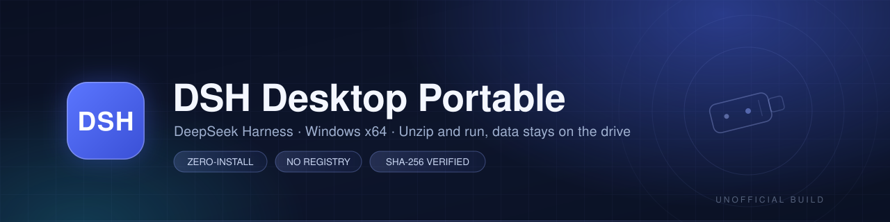

<div align="center">



**DeepSeek Harness, portable.** Unzip and run — no installer, no registry writes.
Sessions, credentials, plugins, caches and the first-run workspace all stay on the drive.

[](https://github.com/yandifei/dsh-desktop-portable/releases) [](https://github.com/yandifei/dsh-desktop-portable/releases) [](https://github.com/yandifei/dsh-desktop-portable/releases) [](https://github.com/yandifei/dsh-desktop-portable/actions/workflows/upstream-check.yml) [](LICENSE)

[简体中文](README.md) · **English**

</div>

> [!WARNING]
> **This is not an official DeepSeek project.** It is not affiliated with, endorsed by, or supported by
> Hangzhou DeepSeek Artificial Intelligence Co., Ltd. “DeepSeek” and “DeepSeek Harness” are trademarks of
> their owner and are used here only to describe the upstream software.
> This project modifies `resources/app.asar`, which upstream does not support — make sure you trust the source
> of a build before signing in with your account.

## ✨ Features

The official desktop app installs into the system drive and writes user data under `%USERPROFILE%`. This project
does one thing: **move every writable path next to the executable**, so the whole installation becomes a folder you
can carry around. The application itself is still the official Electron desktop build; only `resources/app.asar`
is patched.

- **Zero install** — unzip and run. No registry writes, no `PATH` changes, no Start-menu entries, no services.
- **Data travels with the drive** — `DSH_HOME` lives in `<exe>\.dsh`, Electron `userData` in
  `<exe>\@deepseek-ai\dsh-desktop`; sessions, credentials, attachments and login state go with it.
- **Caches stay put** — pnpm store and metadata cache, plugin temp files, updater downloads and staging all
  remain next to the executable.
- **Portable plugins too** — the Host process resolves `USERPROFILE` / `LOCALAPPDATA` to `<exe>\home`, so a
  plugin writing to `~` still lands on the drive.
- **Official binaries** — the Electron binaries keep their official signature; only `lib/main.js` and two
  workspace modules are patched.
- **In-place updates** — `Update-Harness.cmd` fetches the official installer, verifies SHA-512 and the
  Authenticode signature, **extracts it without running it**, re-applies the patches and replaces program files
  while keeping data.
- **Fails safe** — every patch anchor is asserted. When upstream changes shape, the script exits with code 2
  before touching the payload, and the current version keeps working.

## 🚀 Quick start

1. Download `DSH-Desktop-Portable-<version>-win-x64.zip` and its `.sha256` from
   [Releases](https://github.com/yandifei/dsh-desktop-portable/releases).
2. Extract it to your USB drive (NTFS recommended, keep the path short and plain).
3. Double-click `DeepSeek Harness.exe` and sign in or add an API key on the welcome page.
4. To quit, use **tray icon → Quit**, wait for the process to exit, then eject the drive safely.

No installer, launcher script or environment variable is needed. The first run creates `.dsh\`, `home\` and
friends next to the executable.

**Verify before extracting:**

```powershell
Get-FileHash .\DSH-Desktop-Portable-0.2.2-rc.2-win-x64.zip -Algorithm SHA256
Get-Content .\DSH-Desktop-Portable-0.2.2-rc.2-win-x64.zip.sha256
```

The two hashes must match. For troubleshooting, see [docs/troubleshooting.md](docs/troubleshooting.md).

## 🧭 Portable vs. official installer

| | Official installer | This project |
| --- | --- | --- |
| Installation | Run the setup wizard | Unzip and run |
| Program files | System drive (official path) | The folder you extracted |
| User data | `%USERPROFILE%\.dsh` | `<exe>\.dsh` |
| Registry | Written (including the `dsh://` protocol) | None by default; opt in with `DSH_DESKTOP_REGISTER_PROTOCOL=1` |
| Updates | Official updater | Disabled; use `Update-Harness.cmd` |
| New machine | Reinstall | Copy the folder |
| Upstream support | Yes | No (the payload is no longer byte-identical) |

## 📦 Data layout

All paths are relative to the **directory containing the executable**:

| Path | Content |
| --- | --- |
| `.dsh\` | `DSH_HOME`: sessions, attachments, settings, credentials, plugins, runtime |
| `.dsh\profiles\desktop\node_modules` | plugins installed by the plugin manager |
| `.dsh\cache\pnpm-store`, `.dsh\cache\pnpm-cache` | pnpm store and metadata cache |
| `.dsh\plugin-data\` | plugin-specific data (wallpaper engine and similar) |
| `.dsh\workspace\` | default workspace created on first run |
| `home\` | Host user home: `.agents`, `.bili-ai`, `.npmrc`, `AppData\Local` |
| `@deepseek-ai\dsh-desktop\` | Electron cookies, local storage, shortcuts, caches |
| `@deepseek-aidsh-desktop-updater\` | updater downloads, staging, temp files, wallpaper cache |

After extracting, the drive looks roughly like this:

```text
<drive>\
├─ DeepSeek Harness.exe              # the app — double-click to run
├─ Update-Harness.cmd                # portable updater
├─ .dsh\                             # DSH_HOME: sessions / settings / credentials / plugins
├─ home\                             # Host user home (plugin writes to ~ land here)
├─ @deepseek-ai\dsh-desktop\         # Electron data: cookies, local storage, caches
├─ @deepseek-aidsh-desktop-updater\  # updater downloads / staging / temp
└─ docs\                             # documentation
```

<details>
<summary><b>Moving to another drive or machine?</b></summary>

Copy the whole folder (including `.dsh`, `home` and `@deepseek-ai`) and start it there — the login state travels
with it. Workspace paths are absolute, so after a drive-letter change you need to select the workspace once;
session data itself is preserved.

</details>

## 🔄 Updating

Run `Update-Harness.cmd` (or `Update-Harness.ps1`) from the package root, with DeepSeek Harness closed:

1. resolve the newest Windows x64 installer from the official feed;
2. download it to `@deepseek-aidsh-desktop-updater\download`;
3. verify the feed's SHA-512 and the installer's Authenticode signature;
4. extract it to `staging` with WinRAR / 7-Zip (**without running it**);
5. re-apply the patches to the new payload;
6. copy program files over the current root, keeping `.dsh`, `home`, `@deepseek-ai` and
   `@deepseek-aidsh-desktop-updater`;
7. disable the new `app-update.yml` and start the app.

> [!NOTE]
> The updater needs **WinRAR or 7-Zip** installed. If verification or patching fails, it aborts before touching
> any program file, so the current version keeps working. Details in [docs/update.md](docs/update.md).

Rolling back is just restoring a copy of the package folder you kept before updating.

> [!TIP]
> The updater follows the official feed and **never downgrades**: when the package is newer than the feed
> (for example, the feed has not caught up with a release published here) it reports that you are up to date.
> To upgrade manually, extract the matching release zip over the program files, keeping the `.dsh`, `home`,
> `@deepseek-ai` and `@deepseek-aidsh-desktop-updater` data directories untouched.

## 🛠️ Build it yourself

Requirements: Windows 10/11 x64, PowerShell 7, 7-Zip or WinRAR, and network access to `download.deepseek.com`.

```powershell
git clone https://github.com/yandifei/dsh-desktop-portable
cd dsh-desktop-portable

# build the newest upstream version from the official feed
pwsh scripts/build.ps1 -Version latest

# validate the patch anchors only, without producing an archive
pwsh scripts/build.ps1 -Version latest -NoArchive

# verify an artifact: checksum, required files, no personal data
pwsh scripts/verify-release.ps1 -Zip dist\DSH-Desktop-Portable-0.2.2-rc.2-win-x64.zip
```

Output lands in `dist/` as a zip plus a `.sha256`. See [docs/build.md](docs/build.md) for the full flow and for
pinning a specific version.

## 🔍 How it works

`app.asar` is an unencrypted archive (header JSON + concatenated files), so the patch script rewrites it in place:
files are copied with fresh offsets and integrity blocks, only `lib/main.js` and two workspace modules change,
everything else stays untouched. The Authenticode signature covers the exe rather than the asar, so the app still
starts — and because the UI code is modified, this build is unofficial.

| Patch | Effect |
| --- | --- |
| Writable paths | `DSH_HOME`, `TEMP`/`TMP`, Electron `userData`/`sessionData` and `defaultDshHome()` point next to the exe |
| Host home | `USERPROFILE`→`<exe>\home`, `LOCALAPPDATA`→`<exe>\home\AppData\Local`, `HOME` stays the real profile for git/ssh |
| First-run workspace | created under `.dsh\workspace` instead of Documents |
| Protocol | `dsh://` registration becomes opt-in; no registry writes by default |
| Updates | official updater disabled, replaced by the extract-based portable flow |

Full details in [docs/how-it-works.md](docs/how-it-works.md).

## 🔐 Security

- Every release ships a SHA-256; compare it with the published value.
- The build script only extracts the official installer, after verifying its SHA-512 and signature.
- The patch script is small and auditable, and you can build the package yourself.
- Releases contain no credentials, cookies, sessions or personal data.
- A modified `app.asar` can trip heuristic antivirus rules — **only** add an exclusion if you trust the build.
- Never sign in with a real account using a build from an untrusted source.

Report vulnerabilities privately through GitHub Security Advisories; see [SECURITY.md](SECURITY.md).

## ❓ FAQ

<details>
<summary><b>Does it really leave nothing on the system drive?</b></summary>

The application does not: no registry writes (unless you explicitly opt into protocol registration) and all
writable data sits next to the exe. The exception is third-party plugins — a plugin that hardcodes `%APPDATA%` or
absolute paths can still write outside the package.

</details>

<details>
<summary><b>Can it coexist with the official version?</b></summary>

Yes. Program folders and data folders are separate (`%USERPROFILE%\.dsh` vs `<exe>\.dsh`). Just don't extract the
portable build into the official installation directory.

</details>

<details>
<summary><b>Drive letter changed and the workspace is gone?</b></summary>

DSH stores workspace paths as absolute paths, so re-select the workspace once on the new drive letter; session
data stays under `.dsh`. If you switch machines often, give the drive a fixed letter.

</details>

<details>
<summary><b>The updater reports "patch failed"</b></summary>

Upstream changed its JavaScript layout and an anchor no longer matched. The updater aborts before modifying the
payload, so the current version is unaffected. Reproduce locally with
`pwsh scripts/build.ps1 -Version latest -NoArchive`, then update the anchors in `scripts/patch-asar.js` or open an
issue with the upstream version.

</details>

<details>
<summary><b>The updater asks for WinRAR / 7-Zip</b></summary>

It only **extracts** the official installer, never runs it, so an extractor is required. Install either one.

</details>

## ⚠️ Limitations

- Windows x64 only; macOS and Linux are out of scope.
- Because `app.asar` is modified, the payload is no longer byte-identical to the official build, and upstream
  support does not cover it.
- Workspaces are stored as absolute paths; a drive-letter change requires re-selecting them.
- Upstream refactors can break the patch anchors — builds and updates fail safely until the anchors are updated.
- Portability ultimately depends on plugins: one that hardcodes absolute paths can still write outside the package.

## 🤝 Contributing

- Report problems via [Issues](https://github.com/yandifei/dsh-desktop-portable/issues); the template asks for the
  upstream version, which is the key detail for fixing patch anchors.
- PRs are welcome — read [CONTRIBUTING.md](CONTRIBUTING.md) first. **Never commit** `.dsh`, `home`, cookies,
  credentials, build artifacts or any other personal data.
- Keep the patch surface minimal: every extra patch is another thing to maintain when upstream changes.

## 📄 License & credits

Scripts and documentation in this repository are **MIT** licensed (see [LICENSE](LICENSE)). The bundled DeepSeek
Harness payload, Electron, Chromium, Node.js, Python and pnpm keep their own licenses — see
[THIRD_PARTY_NOTICES.md](THIRD_PARTY_NOTICES.md).

Thanks to [DeepSeek Harness](https://github.com/deepseek-ai/deepseek-harness) for the official desktop app; this
project is just a portable shell around it.

<div align="center">

**If this makes your USB-drive DSH nicer to use, a ⭐ is appreciated.**

<sub>Unofficial project, not affiliated with DeepSeek. Report problems via <a href="https://github.com/yandifei/dsh-desktop-portable/issues">Issues</a>.</sub>

</div>
