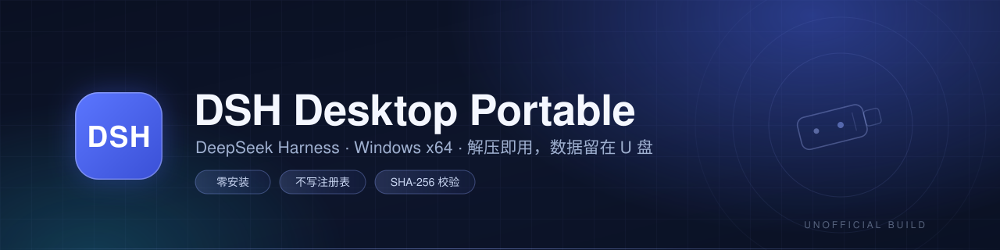

<div align="center">



**DeepSeek Harness 的 Windows 便携版**：解压即用，不跑安装器、不写注册表，
会话 / 凭据 / 插件 / 缓存 / 默认工作区全部留在 U 盘里。

[](https://github.com/yandifei/dsh-desktop-portable/releases/latest) [](https://github.com/yandifei/dsh-desktop-portable/releases/latest) [](https://github.com/yandifei/dsh-desktop-portable/releases/latest) [](https://github.com/yandifei/dsh-desktop-portable/actions/workflows/upstream-check.yml) [](LICENSE)

**简体中文** · [English](README.en.md)

</div>

> [!WARNING]
> **这是非官方项目。** 与杭州深度求索人工智能基础技术研究有限公司无关，未获官方背书或支持。
> “DeepSeek”、“DeepSeek Harness”是其权利人的商标，此处仅用于说明上游软件。
> 本项目修改了 `resources/app.asar`，官方不支持这种用法；请确认下载来源可信后再登录自己的账号。

## ✨ 特性

官方桌面端直接装进系统盘、数据写进 `%USERPROFILE%`。这个项目只做一件事：**把可写路径全部搬到 exe 同级目录**，
让整个程序变成一个可以随身带走的文件夹。程序本体仍是官方 Electron 桌面端，只补丁了 `resources/app.asar`。

- **零安装** — 解压即运行；不写注册表、不改 `PATH`、不建开始菜单、不装系统服务。
- **数据随身** — `DSH_HOME` 落到 `<exe>\.dsh`，Electron 用户数据落到 `<exe>\@deepseek-ai\dsh-desktop`，
  会话、凭据、附件和登录态都跟着盘走。
- **缓存也不越界** — pnpm store / metadata cache、插件临时文件、更新器下载与暂存目录，全在 exe 同级。
- **插件同样便携** — Host 进程的 `USERPROFILE` / `LOCALAPPDATA` 指向 `<exe>\home`，
  插件往 `~` 里写东西也留在盘上。
- **官方内核** — Electron 二进制保持官方签名，只改 `lib/main.js` 与两个 workspace 模块。
- **原地更新** — `Update-Harness.cmd` 从官方 feed 下载安装包，校验 SHA-512 与 Authenticode 签名，
  **解包而不运行安装器**，重新打补丁后覆盖程序文件，数据目录保留。
- **失败即中止** — 每个补丁锚点都有断言；上游结构一变，脚本在动 payload 之前就以退出码 2 停下，
  当前版本继续可用。

## 🚀 快速开始

1. 到 [Releases](https://github.com/yandifei/dsh-desktop-portable/releases/latest) 下载
   `DSH-Desktop-Portable-<版本>-win-x64.zip` 和对应的 `.sha256`。
2. 解压到 U 盘（建议 NTFS，路径尽量短、别带奇怪字符）。
3. 双击 `DeepSeek Harness.exe`，在欢迎页登录账号或填写 API Key。
4. 退出走 **托盘图标 → Quit**，等进程完全退出后再安全弹出 U 盘。

不需要安装器、启动脚本或环境变量。第一次运行会在 exe 同级创建 `.dsh\`、`home\` 等目录。

**解压前先校验：**

```powershell
Get-FileHash .\DSH-Desktop-Portable-0.2.2-rc.2-win-x64.zip -Algorithm SHA256
Get-Content .\DSH-Desktop-Portable-0.2.2-rc.2-win-x64.zip.sha256
```

两行哈希一致再解压。更细的排障见 [docs/troubleshooting.md](docs/troubleshooting.md)。

> [!TIP]
> 解压完整的话是**约 7900 个文件、约 1.1 GB**，其中 `resources\app.asar.unpacked` 一个目录就有一千多个文件。
> 如果解压后目录明显偏小、或找不到 `app.asar.unpacked`，说明下载/解压被中断了——用 7-Zip 重新解压，
> 别在资源管理器里只拖一部分出来。缺了这层 unpacked 文件，应用会以
> `ENOENT ... resources\app.asar.unpacked` 报错退出。

## 🧭 与官方安装版对比

| | 官方安装版 | 本项目（便携版） |
| --- | --- | --- |
| 安装方式 | 运行安装向导 | 解压即可用 |
| 程序位置 | 系统盘（官方安装路径） | 你解压的那个文件夹 |
| 用户数据 | `%USERPROFILE%\.dsh` | `<exe>\.dsh` |
| 注册表 | 写入（含 `dsh://` 协议关联） | 默认不写；需要时设 `DSH_DESKTOP_REGISTER_PROTOCOL=1` |
| 更新通道 | 官方 updater | 已禁用，改用 `Update-Harness.cmd` |
| 换电脑 | 重新安装 | 整个文件夹拷走 |
| 官方支持 | 有 | 无（payload 已不逐字节一致） |

## 📦 数据布局

所有路径都相对 **exe 所在目录**：

| 路径 | 内容 |
| --- | --- |
| `.dsh\` | `DSH_HOME`：会话、附件、设置、凭据、插件、运行时 |
| `.dsh\profiles\desktop\node_modules` | 插件管理安装的插件包 |
| `.dsh\cache\pnpm-store`、`.dsh\cache\pnpm-cache` | 插件下载库与元数据缓存 |
| `.dsh\plugin-data\` | 插件自定义数据（如壁纸引擎） |
| `.dsh\workspace\` | 首次运行创建的默认工作区 |
| `home\` | Host 用户目录：`.agents`、`.bili-ai`、`.npmrc`、`AppData\Local` |
| `@deepseek-ai\dsh-desktop\` | Electron Cookie、LocalStorage、快捷键、缓存 |
| `@deepseek-aidsh-desktop-updater\` | 更新下载、暂存、临时文件、壁纸缓存 |

解压之后，U 盘里的目录大概长这样：

```text
<U 盘>\
├─ DeepSeek Harness.exe              # 主程序，双击运行
├─ Update-Harness.cmd                # 便携更新器
├─ .dsh\                             # DSH_HOME：会话 / 设置 / 凭据 / 插件 / 运行时
├─ home\                             # Host 用户目录（插件写 ~ 也落在这里）
├─ @deepseek-ai\dsh-desktop\         # Electron 数据：Cookie、LocalStorage、缓存
├─ @deepseek-aidsh-desktop-updater\  # 更新下载 / 暂存 / 临时文件
└─ docs\                             # 说明文档
```

<details>
<summary><b>想直接换盘 / 换机器？</b></summary>

把整个文件夹（包含 `.dsh`、`home`、`@deepseek-ai`）一起拷走再启动即可，登录态也在里面。
工作区路径是绝对路径，换了盘符需要在应用里重新选择一次工作区，会话数据本身不会丢。

</details>

## 🔄 更新

双击包内的 `Update-Harness.cmd`（或 `Update-Harness.ps1`），保持 DeepSeek Harness 已关闭：

1. 从官方 feed 解析最新的 Windows x64 安装包；
2. 下载到 `@deepseek-aidsh-desktop-updater\download`；
3. 校验 feed 里的 SHA-512 与安装包的 Authenticode 签名；
4. 用 WinRAR / 7-Zip 解包到 `staging`（**不运行安装器**）；
5. 对新 payload 重新打补丁；
6. 覆盖程序文件，保留 `.dsh`、`home`、`@deepseek-ai`、`@deepseek-aidsh-desktop-updater`；
7. 把新的 `app-update.yml` 改名禁用，然后启动应用。

> [!NOTE]
> 更新需要本机装有 **WinRAR 或 7-Zip**。校验或补丁失败时更新器会在覆盖任何程序文件前退出，
> 现有版本照常可用。细节见 [docs/update.md](docs/update.md)。

回滚很简单：更新前把整个包目录复制一份，需要时换回去即可。

> [!TIP]
> 更新器只跟随官方 feed，并且**不会降级**：如果当前包比 feed 上的版本还新（例如官方还没推进到 Release 里的
> 版本），它会提示已经是最新。想手动升级时，下载对应版本的 zip 解压覆盖程序文件即可，`.dsh`、`home`、
> `@deepseek-ai`、`@deepseek-aidsh-desktop-updater` 这些数据目录不要动。

## 🛠️ 自己构建

环境：Windows 10/11 x64、PowerShell 7、7-Zip 或 WinRAR、能访问 `download.deepseek.com`。

```powershell
git clone https://github.com/yandifei/dsh-desktop-portable
cd dsh-desktop-portable

# 从官方 feed 构建最新版
pwsh scripts/build.ps1 -Version latest

# 只校验补丁锚点，不产出压缩包（上游一更新就跑这个）
pwsh scripts/build.ps1 -Version latest -NoArchive

# 验证成品：校验和、必需文件、是否混入个人数据
pwsh scripts/verify-release.ps1 -Zip dist\DSH-Desktop-Portable-0.2.2-rc.2-win-x64.zip
```

产物在 `dist/`，包含 zip 和 `.sha256`。构建流程与固定版本的写法见 [docs/build.md](docs/build.md)。

## 🔍 工作原理

`app.asar` 是未加密的归档（JSON 头 + 拼接文件），所以补丁脚本可以原位重写它：
重新计算偏移与完整性块，只替换 `lib/main.js` 和两个 workspace 模块，其余文件原样保留。
Electron 的 Authenticode 签名覆盖 exe 而非 asar，因此程序仍能正常启动——也正因改过 UI 代码，它是非官方的。

| 补丁 | 作用 |
| --- | --- |
| 可写路径 | `DSH_HOME`、`TEMP`/`TMP`、Electron `userData`/`sessionData`、`defaultDshHome()` 全部指向 exe 同级 |
| Host 用户目录 | `USERPROFILE`→`<exe>\home`，`LOCALAPPDATA`→`<exe>\home\AppData\Local`，`HOME` 保持真实用户以兼容 git/ssh |
| 默认工作区 | 首次运行落在 `.dsh\workspace`，不再写「文档」 |
| 协议注册 | `dsh://` 关联改为可选，默认不写注册表 |
| 更新 | 禁用官方 updater，替换为解包式的便携更新流程 |

完整说明见 [docs/how-it-works.md](docs/how-it-works.md)。

## 🔐 安全

- 每个 Release 都附带 SHA-256，请与发布值比对。
- 构建脚本只从官方安装包解包，先验 SHA-512 与数字签名，再打补丁。
- 补丁脚本很小、可审计，你也可以自己从源码构建。
- Release 不包含任何凭据、Cookie、会话或个人数据。
- 改了 `app.asar` 可能被杀软的启发式规则误报；**确认来源可信**后再加白名单。
- 不要用来源不明的预构建包登录真实账号。

漏洞请通过 GitHub Security Advisories 私下报告，见 [SECURITY.md](SECURITY.md)。

## ❓ 常见问题

<details>
<summary><b>真的完全不在 C 盘留东西吗？</b></summary>

程序自身不会：不写注册表（除非你显式开启协议注册），可写数据都在 exe 同级。
例外是你自己安装的第三方插件——如果它硬编码 `%APPDATA%` 或绝对路径，仍可能写到系统盘。

</details>

<details>
<summary><b>能和官方版同时装吗？</b></summary>

可以。两者目录独立、数据目录也独立（`%USERPROFILE%\.dsh` 与 `<exe>\.dsh`），互不影响。
只是别把便携版解压到官方安装目录里。

</details>

<details>
<summary><b>换了盘符，工作区不见了？</b></summary>

DSH 把工作区路径存成绝对路径，换盘符后需要在应用里重新选择一次；会话仍留在 `.dsh` 下。
经常换机器的话，建议给 U 盘固定一个盘符。

</details>

<details>
<summary><b>更新时提示 patch failed？</b></summary>

上游 JS 结构变了，补丁锚点没匹配上。更新器在动 payload 之前就中止了，当前版本不受影响。
可以先本地跑 `pwsh scripts/build.ps1 -Version latest -NoArchive` 复现，再更新 `scripts/patch-asar.js` 的锚点，
或者直接带上游版本号开 issue。

</details>

<details>
<summary><b>更新时提示需要 WinRAR / 7-Zip？</b></summary>

更新器只会**解包**官方安装包、不会运行它，所以需要一个解包工具。装任一即可。

</details>

## ⚠️ 已知限制

- 仅支持 Windows x64；macOS / Linux 不在范围内。
- 改过 `app.asar`，与官方 payload 不再逐字节一致，官方不支持这种用法。
- 工作区存的是绝对路径，换盘符需重新选择。
- 上游代码结构一变，补丁可能失效——构建/更新会在覆盖前失败退出，需要同步更新锚点。
- 便携性最终取决于插件：硬编码绝对路径的插件仍可能写到盘外。

## 🤝 贡献与反馈

- 问题、报错请提 [Issue](https://github.com/yandifei/dsh-desktop-portable/issues)（模板里会问上游版本号，
  这个信息对定位补丁很有用）。
- 欢迎 PR，提交前读一遍 [CONTRIBUTING.md](CONTRIBUTING.md)：**不要提交** `.dsh`、`home`、Cookie、凭据、
  构建产物等任何个人数据或生成文件。
- 希望保持补丁面最小——每多一个补丁，上游一变就多一处维护成本。

## 📄 许可证与致谢

仓库内的脚本与文档是 **MIT**（见 [LICENSE](LICENSE)）；随包发布的 DeepSeek Harness payload、
Electron、Chromium、Node.js、Python、pnpm 等各自遵循其原许可证，详见
[THIRD_PARTY_NOTICES.md](THIRD_PARTY_NOTICES.md)。

感谢 [DeepSeek Harness](https://github.com/deepseek-ai/deepseek-harness) 官方桌面端提供的基础；
本项目只是它的一个可携带外壳。

<div align="center">

**如果它让你的 U 盘 DSH 更好用，欢迎点个 ⭐**

<sub>非官方项目，与 DeepSeek 官方无关。问题请走 <a href="https://github.com/yandifei/dsh-desktop-portable/issues">Issues</a>。</sub>

</div>
